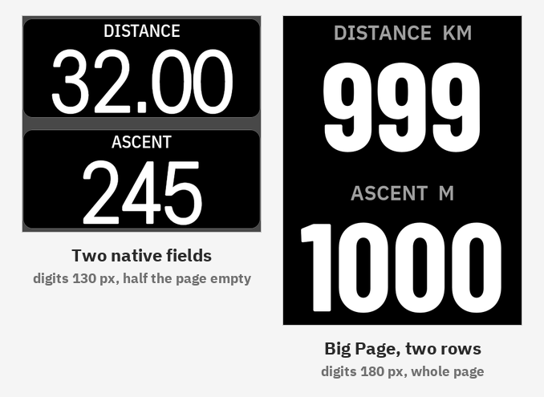
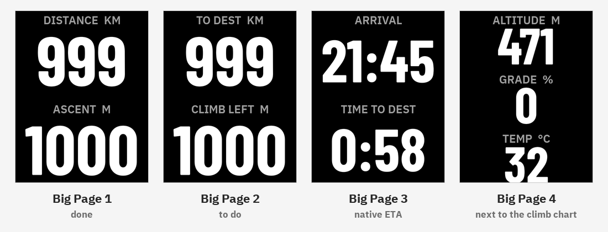
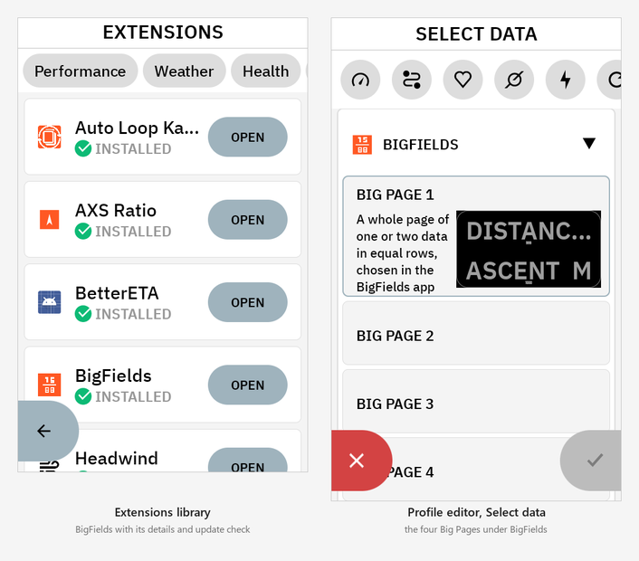
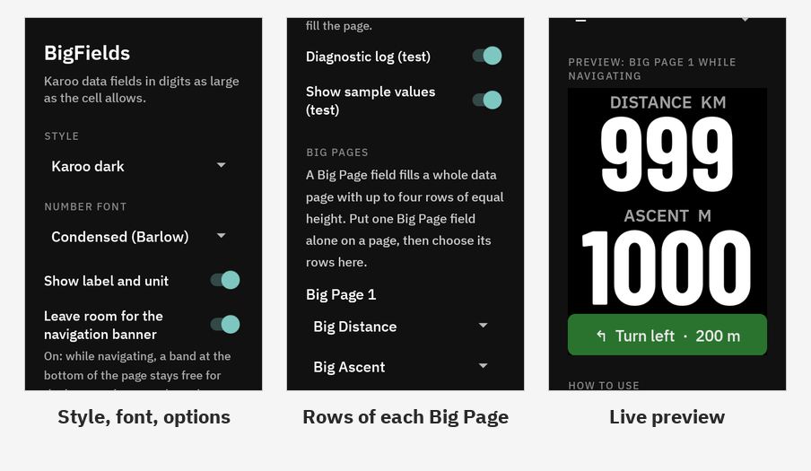
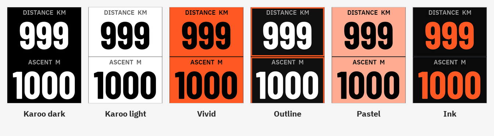
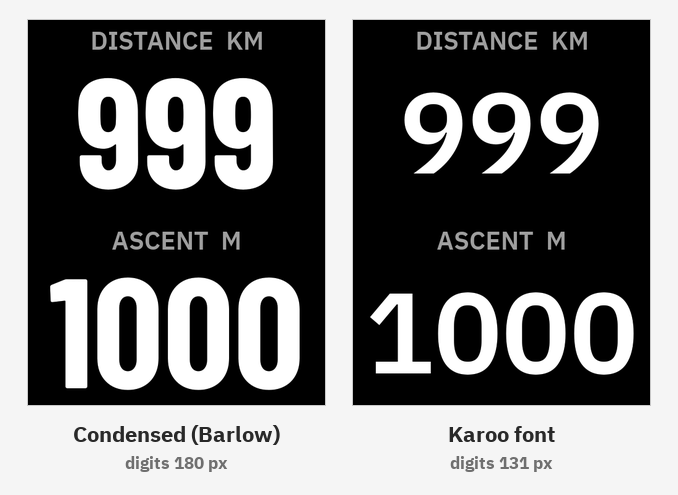

# BigFields

> **Version 1.0** — install the APK from the [latest release](../../releases/latest/download/BigFields.apk).

Karoo data fields in digits as large as the screen allows. Made for riders who would rather not **have to** wear reading glasses on the bike to read their numbers at a glance.

## Why

On the Karoo 3 the numbers of the native data fields stop growing at a fixed text size (96 sp, as the Karoo itself reports to extensions), whatever the size of the cell. The page editor also decides the height of each field on its own: with two native fields the digits are 130 px tall and half of the page stays empty. Other bike computers, Wahoo for one, fill the screen when a page shows only two values, and use narrow, tall digits that read well from a distance.

BigFields brings that to the Karoo:

- **Whole-page fields.** A *Big Page* is one field that takes the whole data page and shows one or two values in rows of equal height. You choose the rows in the BigFields app.
- **Digits fitted to the cell.** The number is drawn to fill its row, measured on the real outline of the digits rather than on the line of text.
- **A condensed font.** In a half-page row the limit is the width, and the Karoo font has digits almost as wide as they are tall. BigFields uses Barlow Condensed, whose digits grow taller in the same space.
- **The same height on the whole page.** All numbers on a page have the same digit height, like native fields, so the page reads as one.
- **Steady numbers.** A field keeps one size for its typical width: going from 9.8 to 10.2 km/h, or from 99 to 100 bpm, does not make the number jump.

The result, measured on a Karoo 3 with two values on a page:

| | Digit height |
|---|---|
| Two native fields | 130 px |
| Big Page, Karoo font | 131 px |
| **Big Page, condensed font** | **180 px** (+38 %) |

## Big Pages

Four Big Page fields are available, each with its own rows. They start with pages that are common on a mountain bike ride; change them in the app.

| Field | Default rows |
|---|---|
| Big Page 1 | distance, ascent |
| Big Page 2 | distance to destination, climb left |
| Big Page 3 | arrival time, time to destination (Karoo estimate) |
| Big Page 4 | altitude, grade |

Any of the 32 single fields below can be a row. A Big Page has at most two rows: with three, the digits would be about as tall as native fields, and the reason for a Big Page would be gone.

## Single fields

32 fields, each reading one native Karoo value, to mix with native fields on the same page: speed (current, 3 s, average, max), heart rate (current, average), power (current, 3 s, average, normalized), cadence, distance, ride time, elapsed time, time of day, grade, altitude, ascent, distance / time / arrival to destination, climb left, next turn, distance and climb to the top, lap time / distance / speed / power, temperature, battery, calories.

Single fields on the same page also share one digit height. Units follow the Karoo user profile, metric or imperial. Distances from 100 km up are shown without a decimal, so a three-digit road ride keeps the full size.

## Install

1. Download [`BigFields.apk`](../../releases/latest/download/BigFields.apk) from the latest release.
2. Sideload it onto the Karoo, for example with `adb install -r BigFields.apk`, or copy it to the device and open it there.
3. Open **BigFields** from the app list and choose style, font and the rows of each Big Page.
4. In the Karoo profile editor, add a data page and put **one** field on it: *Big Page 1* (or 2, 3, 4) from the BigFields extension. A Big Page must be alone on its page to get the whole screen.
5. Or add single *Big* fields next to native ones.

Changes made in the app show on the ride pages as soon as you leave it. No permission is needed. It is not on the Hammerhead app store, but once installed it appears in the Karoo **Extensions** library with its description, screenshots and version, and the Karoo checks there for a newer release. New versions install over the old one with the same command; settings are kept and there is no need to uninstall first.

## Settings

- **Style**: the colours of every field, see below.
- **Number font**: *Condensed (Barlow)*, the default, or the *Karoo* font.
- **Show label and unit**: the small caption above each number. In a two-row page the numbers are limited by the width, so hiding the caption does not make them larger; it helps on pages with three or four rows.
- **Leave room for the navigation banner**: while navigating, the Karoo draws its turn banner over the bottom of the page and does not tell extensions. With this option on, a Big Page keeps a band free at the bottom while navigation is active, and the rows share the rest equally. Without navigation the rows always fill the page.
- **Big Pages**: one or two rows for each Big Page; *—* leaves a row out. The preview below shows the page as it will look while navigating.
- **Diagnostic log (test)** and **Show sample values (test)**: for testing, see the technical notes.

## Styles

| Style | Look |
|---|---|
| Karoo dark | white on black, like the native dark theme |
| Karoo light | black on white |
| Vivid | black on orange; heart rate and power take the colour of their zone |
| Outline | white on near-black, zone colour on the border |
| Pastel | black on light tints, zone tint for heart rate and power |
| Ink | orange on black, zone colour on the number |

Every pairing of text and background meets WCAG AA contrast (4.5:1), checked by a unit test.

## Font

Numbers are drawn in Barlow Condensed Bold by default. On a Karoo 3 its digits are 37 % taller than the Karoo's own font in the same row. The Karoo font is one switch away in the app. Labels always use the Karoo font.

## Technical notes

- **How a field is drawn.** Karoo extensions draw their fields with Android RemoteViews in the ride app. Letting a TextView size its own text fills the line of text, not the digits: on the Karoo the digits covered about half of the cell. BigFields draws each number into a one-channel bitmap sized on the real glyph bounds of a template ("88.8", "188", "8:88:88"...) and lets the ImageView tint it with the style colour. The template fixes the size of a field, so the number never jumps; a number wider than its template shrinks on its own and never leaves its cell.
- **One height per page.** Single fields report the tallest digits their cell allows and all fields on the visible page draw at the lowest. A Big Page computes all its rows in one pass with one look.
- **Karoo constraints met on the way.** The ride app ignores `setViewVisibility` and `setTextViewTextSize`, so every combination of rows, caption and banner band is its own layout (20 layouts, same ids). RemoteViews refuse a plain `View`: a unit test checks every layout. While the BigFields app is in front, the ride screen is paused and can drop the last update, so every field redraws when it becomes visible again and one second after the app closes.
- **Data.** Values come from the Karoo streams of each native data type. Without a recording the Karoo sends no values and fields show "--". Speed, distances and time to destination were checked against the Karoo; other units (durations in ms, temperature in °C, lap power as average) are assumed and logged on first use.
- **Log.** `Android/data/com.anpaiss.bigfields/files/big_fields.log`, three generations of 1 MB. Always written: version, start, cell sizes with the native text size, first state of each data type, visible page, settings changes, drawing errors, crashes with their stack. With *Diagnostic log* on: data state changes and a per-minute redraw summary for each visible field. *Show sample values* fills fields with realistic maximum values (999 km, 1000 m) when the Karoo sends none, for screenshots and tests; turn it off for a ride.
- **Tested on** a Karoo 3 (Android 12, 480 × 800 px). The Karoo 2 is supported by the SDK but untested.

## Known limitations

- No "more or fewer fields" gesture during the ride: extensions cannot change the Karoo page layout.
- The height of the navigation banner is an estimate (100 px) until it is measured on a ride.
- Fields from other extensions are a planned addition, for extensions that publish their value as a number.

## Feedback

Bug reports and ideas are welcome as [issues](../../issues). Please include the Karoo model, the Karoo OS version and, if you can, the log file.

## License

MIT, see [LICENSE](LICENSE). The bundled Barlow Condensed font is licensed under the SIL Open Font License 1.1 ([`app/src/main/assets/OFL-BarlowCondensed.txt`](app/src/main/assets/OFL-BarlowCondensed.txt)).
